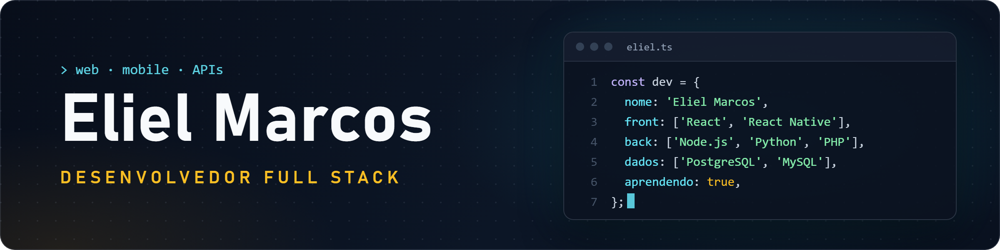

  

### Olá, eu sou o Eliel 👋

- 💼 Desenvolvo um **sistema de separação de pedidos** para uma distribuidora de autopeças: API, painel web, app do separador e integração com o ERP.
- 📦 Trabalho com problemas de operação real: fila de pedidos, rota de coleta no estoque, rupturas e sincronização com o ERP.
- 🐍 Também tenho projetos em Python (Flask, NLP com IA) e PHP com Laravel, listados abaixo.

### No que estou trabalhando

**Sistema de separação de pedidos** · _repositório privado_

- **API** em Node.js, Express 5 e TypeScript, com PostgreSQL e Redis
- **Painel web** em React + Vite, onde o gestor acompanha e reordena a fila de pedidos e manda mensagens aos separadores
- **App do separador** em React Native (Expo) com coleta **offline-first**: dados locais em SQLite e eventos em sequência, com idempotência, para sincronizar com o servidor
- **Integração com o ERP** por uma fila durável (padrão outbox), sem escrita direta no ERP
- Docker, testes automatizados e CI no GitHub Actions

### Tecnologias

  

### Projetos

| Projeto | O que faz | Stack |
| --- | --- | --- |
| [email-classifier](https://github.com/yazei132/email-classifier) | Classifica e-mails em produtivos ou improdutivos e sugere uma resposta; se a IA falhar, usa regras por palavras-chave | Python, Flask, Google Gemini, NLTK |
| [to-do-list](https://github.com/yazei132/to-do-list) | Lista de tarefas com cadastro e login, em que cada usuário gerencia só as próprias tarefas | PHP, Laravel 12, Blade, Bootstrap 5 |
| [shortenert-url](https://github.com/yazei132/shortenert-url) | App de desktop que encurta links longos para deixar e-mails corporativos mais limpos | Python, Tkinter, TinyURL |
| [Targe](https://github.com/yazei132/Targe) | Exercícios de lógica: comissão de vendas, juros por atraso e controle de estoque | Python |
| [Desafios_Python](https://github.com/yazei132/Desafios_Python) | Perguntas de lógica de programação, carregadas de um arquivo JSON | Python |
